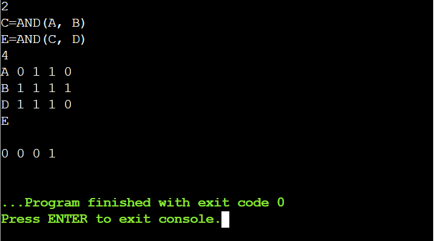
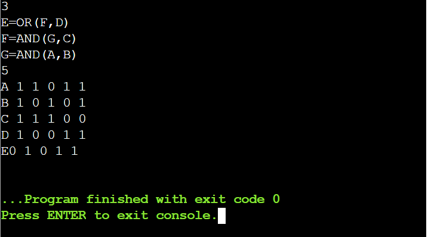

# 01 · Shannon Circuits

**Language:** C · **Topic:** Simulation, digital logic · **Source:** TCS CodeVita practice

[Run it on OnlineGDB](https://onlinegdb.com/3MLf_rJbeY)

---

## Problem

A digital circuit is built only from two-input gates: AND, OR, NAND, NOR and XOR. Each gate reads its inputs in the current clock cycle and shows the result in the **next** cycle, and every gate outputs 0 in cycle 1. Given the input signals for T clock cycles, print the output of one requested gate for every cycle.

**Input**
- Line 1: N, the number of gates
- Next N lines: one gate each, written as `OUT=GATE(IN1, IN2)`
- Next line: T, the number of clock cycles
- Next lines: one input signal each, as its name followed by T bits
- Last line: the name of the gate to report

**Output:** T space-separated bits, the requested gate's output in cycles 1 to T.

**Constraints:** fewer than 20 gates and fewer than 20 cycles; signal names are single letters in any case.

---

## Approach

1. **Index signals by letter.** Every signal name is a single letter, so each one gets an array slot indexed by its character. No maps or string lookups are needed.
2. **Parse gates robustly.** Only the letters in a gate line are kept, so `C=AND(A, B)` becomes `CANDAB`: the first letter is the output, the last two are the inputs, and the rest is the operation. This makes spacing and letter case irrelevant.
3. **Simulate one clock tick at a time.** In cycle 1 every gate outputs 0. In each later cycle, every gate is computed from the values its inputs had in the previous cycle, so chained gates pick up the correct delay automatically.
4. **Print** the stored values of the requested gate.

**Complexity:** O(G × T) time and memory. With G, T < 20, it runs instantly.

---

## Sample tests

| # | Input | Expected | Result |
|---|---|---|---|
| 1 | [`sample1.txt`](sample1.txt) | `0 0 0 1` | Pass |
| 2 | [`sample2.txt`](sample2.txt) | `0 1 0 1 1` | Pass |

### Test 1 output


### Test 2 output


*(In test 2 the answer appears right after `E` because the input was ended without a final newline. The printed output is `0 1 0 1 1`.)*

---

## Run it locally

```bash
gcc shannon_circuits.c -o shannon_circuits
./shannon_circuits < sample1.txt
```
