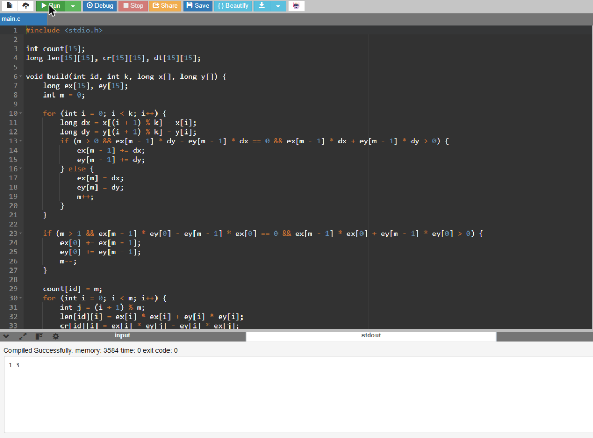

# 02 · Find The Pairs

**Language:** C · **Topic:** Computational geometry, shape matching · **Source:** TCS CodeVita practice

[Run it on OnlineGDB](https://onlinegdb.com/nnfzmGQc1)

---

## Problem

You're given N earrings, each drawn as a polygon on a 2D grid with its corners listed anticlockwise. Exactly one pair of earrings has the same shape: one can be **rotated by any angle and moved** to sit exactly on the other. A **mirror image does not count**. Print the numbers of that pair.

**Input**
- Line 1: N, the number of earrings
- Then N blocks: K (number of corners), followed by K lines of `x y`, anticlockwise

**Output:** the two earring numbers (1-based, in input order), smallest first.

**Constraints:** 2 < N < 10, 2 < K < 10, 0 ≤ x, y ≤ 10

---

## Approach

The idea is to describe each polygon in a way that stays the same no matter where the shape is placed or how it's turned, then look for two equal descriptions.

1. **Edges instead of points.** Each side becomes a vector from one corner to the next. Vectors don't care where the shape sits on the grid, so moving it changes nothing.
2. **Drop extra points on straight sides.** A corner in the middle of a straight side doesn't change the shape, so consecutive edges pointing the same way are merged. This way, two identical shapes always end up with the same number of corners.
3. **Describe each corner with three integers:**
   - the side's length squared,
   - the **cross product** with the next side, which tells you which way and how sharply the shape turns,
   - the **dot product** with the next side, which pins down the exact angle.

   Lengths, cross products and dot products don't change when you rotate the shape. But a mirror flips the sign of every cross product, so a mirrored earring gets a different description, exactly as the rules require.
4. **Ignore the starting corner.** The same polygon can be listed starting from any corner, so when two earrings are compared, every possible starting point of the second one is tried.
5. **Compare every pair** of earrings; the first pair that matches is the answer.

Everything is integer arithmetic, so there are no floating-point rounding problems.

**Complexity:** O(N²·K²), which is instant for N, K < 10.

---

## Sample tests

| # | Input | Expected | Result |
|---|---|---|---|
| 1 | [`sample1.txt`](sample1.txt) | `1 3` | Pass |
| 2 | [`sample2.txt`](sample2.txt) | `4 6` | Pass |

In sample 1, earring 1 is a 2×1 rectangle and earring 3 is a 1×2 rectangle: the same shape turned 90°.

### Test 1 output


### Test 2 output


Extra checks run while building this:
- An L-shape and its **mirror image** are correctly **not** matched.
- An L-shape with an extra point in the middle of one side **is** matched with the plain L-shape.

---

## Run it

```bash
gcc find_the_pairs.c -o find_the_pairs
./find_the_pairs < sample1.txt
```
